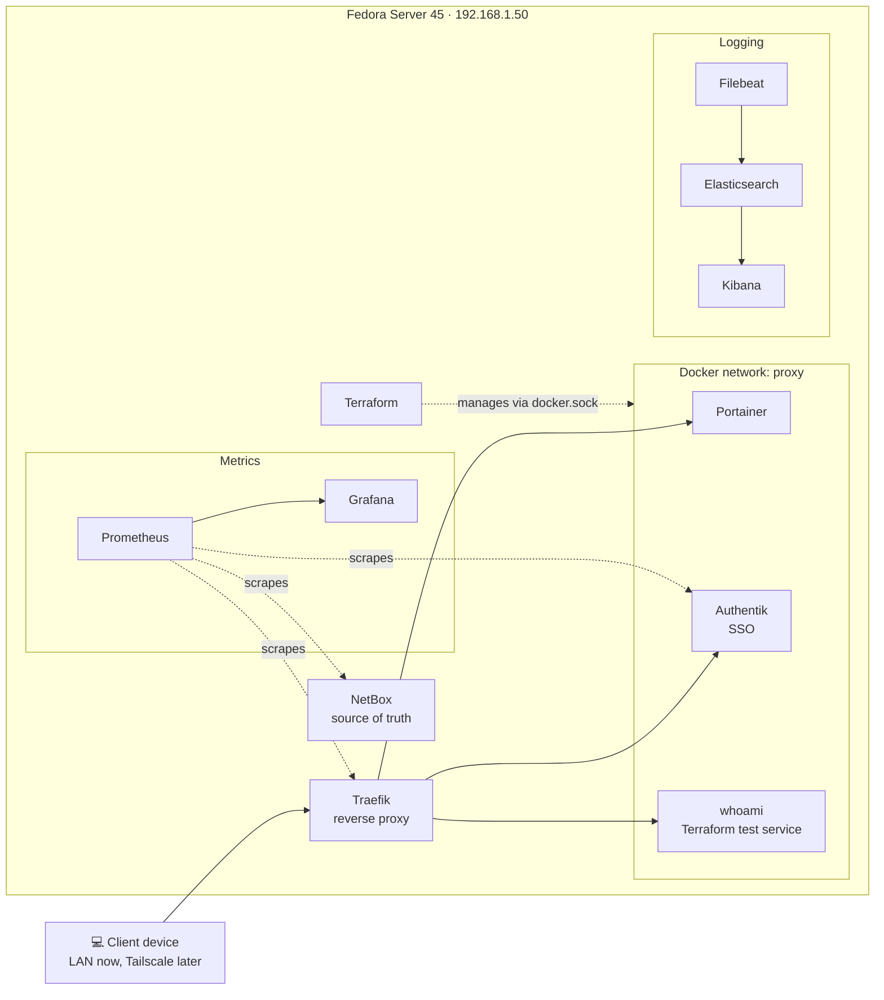
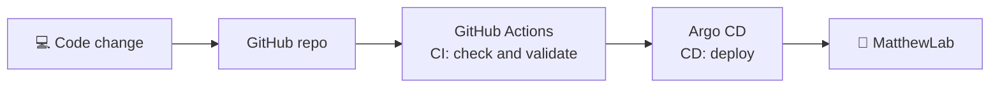

<div align="center">

# 🧪 MatthewLab

**A self-hosted homelab, rebuilt from scratch with a clear purpose.**


</div>

> 🚧 **Status:** Actively being built. Core platform, monitoring and logging are running; HTTPS is in progress and CI/CD is up next. Last updated November 2026.

---

## Table of Contents

- [📖 Background](#-background)
- [💻 Hardware](#-hardware)
- [🧭 Architecture](#-architecture)
- [🧱 The Stack](#-the-stack)
- [🎯 Goals](#-goals)
- [🔨 Build Log](#-build-log)
  - [Phase 1: Operating System and Static IP](#phase-1-operating-system-and-static-ip)
  - [Phase 2: SSH Key Authentication](#phase-2-ssh-key-authentication)
  - [Phase 3: Docker and Portainer](#phase-3-docker-and-portainer)
  - [Phase 4: Authentik Single Sign-On](#phase-4-authentik-single-sign-on)
  - [Phase 5: Traefik Reverse Proxy](#phase-5-traefik-reverse-proxy)
  - [Phase 6: Terraform Infrastructure as Code](#phase-6-terraform-infrastructure-as-code)
  - [Phase 7: NetBox Network Source of Truth](#phase-7-netbox-network-source-of-truth)
  - [Phase 8: Monitoring with Prometheus and Grafana](#phase-8-monitoring-with-prometheus-and-grafana)
  - [Phase 9: Logging with the ELK Stack](#phase-9-logging-with-the-elk-stack)
  - [Phase 10: Running with the Lid Closed](#phase-10-running-with-the-lid-closed)
  - [Phase 11: HTTPS and Remote Access](#phase-11-https-and-remote-access)
- [🐛 Troubleshooting](#-troubleshooting)
- [💡 Lessons Learned](#-lessons-learned)
- [🚀 Roadmap](#-roadmap)

---

## 📖 Background

My homelab started life on an old laptop that I converted into a server. I experimented with a lot of different services, but I never had a clear idea of what I wanted the lab to be or how the pieces should fit together. Over time, things broke or didn't behave the way I intended, and because nothing was planned or documented, it was hard to work out why.

This project is my fresh start: a deliberate, well-planned rebuild. Every service has a reason to be here, every step is documented in this README, and as much as possible is defined as code so the whole lab can be rebuilt reliably.

---

## 💻 Hardware

| Component | Details |
|---|---|
| **Machine** | Repurposed laptop, running headless as a dedicated server |
| **Memory** | ~15 GB RAM |
| **Storage** | ~250 GB disk, with the root volume extended to use all of it ([Phase 9](#phase-9-logging-with-the-elk-stack)) |
| **CPU** | Older x86-64 CPU without AVX2 (no x86-64-v3 support), which limits which container image versions it can run ([Phase 9](#phase-9-logging-with-the-elk-stack)) |
| **Network** | Home LAN with a static IP of `192.168.1.50` |
| **Power** | Lid-close suspend disabled so it keeps running with the lid shut ([Phase 10](#phase-10-running-with-the-lid-closed)) |

---

## 🧭 Architecture

Everything runs as Docker containers on a single Fedora Server host. Traefik is the front door, Authentik handles identity, and the observability tools watch everything else.



**How a request flows**

1. A client on my network requests a hostname such as `whoami.192.168.1.50.nip.io`.
2. Traefik receives the request, matches the hostname against its router rules, and forwards it to the right container on the shared `proxy` Docker network.
3. Authentik provides the login layer, so one account works across services.
4. Prometheus scrapes metrics from Traefik, Authentik and NetBox, and Grafana turns them into dashboards.
5. Filebeat ships container logs into Elasticsearch, which I search and visualise in Kibana.
6. Terraform talks to Docker through the local socket to create containers, volumes and Traefik routes from code.

---

## 🧱 The Stack

| Layer | Choice | Status | Why |
|---|---|---|---|
| **Operating System** | Fedora Server 45 | ✅ Running | Tried Proxmox, Ubuntu and a few others, but Fedora won out. Its short release cycle makes it fun to run the latest features. |
| **Container Runtime** | Docker | ✅ Running | Running a single node meant choosing between Podman and Docker. Docker won thanks to its long history, extensive documentation and Docker Compose support. |
| **Container Management** | Portainer | ✅ Running | The container management UI that worked best for me. One dashboard for every container, network, volume and log. |
| **Single Sign-On** | Authentik | ✅ Running | One login for everything. Sign in once and get access to all my services. |
| **Reverse Proxy** | Traefik | ✅ Running | Discovers containers automatically from Docker labels. Alternatives like Nginx Proxy Manager gave me security and usability concerns. |
| **Infrastructure as Code** | Terraform | ✅ Running | Defines containers, volumes and routes as code instead of clicking through UIs. |
| **Network Source of Truth** | NetBox | ✅ Running | One place to document devices, IP addresses and services as the lab grows. |
| **Metrics and Dashboards** | Prometheus + Grafana | ✅ Running | Shows whether my containers are healthy and how they're performing. |
| **Logging** | ELK stack + Filebeat | ✅ Running | Centralised, searchable logs from every container. |
| **HTTPS** | Traefik + TLS certificate | 🚧 In progress | Encrypted connections so I can log in safely from outside my network. |
| **VPN** | Tailscale | 📋 Planned | The tunnel I'll use to connect to the lab when I'm outside my network. |
| **CI** | GitHub Actions | 📋 Planned | Easier to start with than Jenkins and lives right next to the code. |
| **CD** | Argo CD | 📋 Planned | Deployments driven from the Git repo. |

<sub>✅ Running · 🚧 In progress · 📋 Planned</sub>

---

## 🎯 Goals

- **Stable:** services survive reboots, updates and lid closes, and restart on their own.
- **Secure:** every service sits behind Traefik and a single sign-on with Authentik, and remote access goes over HTTPS and a VPN.
- **Easy to maintain:** everything is defined as code with Docker Compose and Terraform, so the lab can be rebuilt from this repo.
- **Observable:** metrics and logs for every service, so problems are spotted early.
- **Automated:** changes flow through a CI/CD pipeline instead of manual edits.
- **Documented:** every step, decision and fix is written down here.

---

## 🔨 Build Log

Each phase follows the same format: the goal, what I did, how it works, any problems I hit, and screenshots.

### Phase 1: Operating System and Static IP

> 🎯 **Goal:** Install a clean OS and give the server a fixed address every service can rely on.<br>
> 🧰 **Tools:** Fedora Server 45<br>
> 📌 **Status:** ✅ Complete

**What I did**

- Installed Fedora Server 45 as a fresh install on the laptop.
- Gave the server a static IP address of `192.168.1.50`.

**How it works**

A server's address needs to stay the same. If the router hands out a different IP after a reboot, every bookmark, hostname and proxy rule pointing at the server breaks. Pinning it to `192.168.1.50` gives everything else a stable foundation, and the Terraform config uses it directly as the `server_ip` variable.

<p align="center">
  <br>
  <sub>Installing Fedora Server and setting the static IP</sub>
</p>

---

### Phase 2: SSH Key Authentication

> 🎯 **Goal:** Log in to the server securely without typing a password every time.<br>
> 🧰 **Tools:** OpenSSH<br>
> 📌 **Status:** ✅ Complete

**What I did**

- Generated an SSH key pair on my main computer.
- Added the public key to the server so it trusts that key for logins.

**How it works**

SSH keys come in pairs. The server keeps my **public** key in `~/.ssh/authorized_keys`, and when I connect, my computer proves it holds the matching **private** key. No password is sent, and keys are far harder to brute-force than passwords.

<p align="center">
  <br>
  <sub>Setting up SSH key authentication</sub>
</p>

---

### Phase 3: Docker and Portainer

> 🎯 **Goal:** Install the container runtime and a UI to monitor containers and networks.<br>
> 🧰 **Tools:** Docker, Docker Compose, Portainer<br>
> 📌 **Status:** ✅ Complete

**What I did**

- Installed Docker and Docker Compose.
- Deployed Portainer as a container to monitor my Docker containers and networks.

**How it works**

Docker runs each service in its own isolated container, so services don't conflict with each other or with the host. Portainer connects to the Docker engine and gives me a single dashboard to see what's running, read logs, inspect networks and volumes, and restart containers without needing to SSH in. Honestly, it's one of the most useful services I've ever used.

<p align="center">
  <br>
  <sub>Portainer: managing containers and networks</sub>
</p>

---

### Phase 4: Authentik Single Sign-On

> 🎯 **Goal:** One login for every service in the lab.<br>
> 🧰 **Tools:** Authentik<br>
> 📌 **Status:** ✅ Deployed · 🚧 Rolling SSO out to every service

**What I did**

- Deployed Authentik as my single sign-on system.
- Worked through the initial setup to create my admin account.

**How it works**

Authentik is an identity provider. Instead of each service keeping its own usernames and passwords, services hand the login off to Authentik (using OIDC, SAML or Traefik forward-auth). That means one account, one password, and one place to manage access and multi-factor authentication for the whole lab.

**Problems and fixes**

- ⚠️ **Problem:** During initial setup, Authentik wouldn't accept my setup token.
- ✅ **Fix:** I bypassed it by having Authentik read the setup token straight from a file, which removed that step from the login process and let setup complete.

<p align="center">
  <br>
  <sub>Authentik up and running</sub>
</p>

---

### Phase 5: Traefik Reverse Proxy

> 🎯 **Goal:** Clean, safe URLs for every service instead of remembering IP addresses and ports.<br>
> 🧰 **Tools:** Traefik<br>
> 📌 **Status:** ✅ Complete (routes configured for Portainer and Authentik)

**What I did**

- Deployed Traefik as the single entry point to the lab.
- Created a shared Docker network called `proxy` that Traefik and the services it routes to all join.
- Configured routes for Portainer and Authentik.

**How it works**

A reverse proxy sits in front of every service. All web traffic arrives at Traefik, which looks at the requested hostname and forwards the request to the right container. Traefik watches Docker directly and reads **labels** on each container, so adding a route just means adding labels:

| Label | What it does |
|---|---|
| `traefik.enable=true` | Opts the container in to Traefik |
| `traefik.http.routers.<name>.rule=Host(...)` | Sets which hostname routes to this container |
| `traefik.http.routers.<name>.entrypoints=web` | Sets which Traefik entrypoint (port) the route listens on |
| `traefik.http.services.<name>.loadbalancer.server.port` | Sets which port inside the container receives the traffic |

I chose Traefik over alternatives like Nginx Proxy Manager because of security and usability concerns with them, and because label-based discovery fits perfectly with managing services as code.

<p align="center">
  <br>
  <sub>Traefik reverse proxy setup (1 of 2)</sub>
</p>

<p align="center">
  <br>
  <sub>Traefik reverse proxy setup (2 of 2)</sub>
</p>

---

### Phase 6: Terraform Infrastructure as Code

> 🎯 **Goal:** Create and change services with code instead of by hand.<br>
> 🧰 **Tools:** Terraform, `kreuzwerker/docker` provider (~> 3.6), `goauthentik/authentik` provider (~> 2026.8.0)<br>
> 📌 **Status:** ✅ Complete (foundation and first module in place)

**What I did**

- Set up a Terraform project that talks to Docker through the local socket.
- Wrote a reusable `web-service` module: give it a name, image, port and hostname, and it creates the image, container, volumes and Traefik labels for me.
- Deployed a `whoami` test container through the module to prove the full path from Terraform to Docker to Traefik works.
- Added the Authentik provider and a sensitive `authentik_token` variable, ready for managing Authentik with code next.

**Project layout**

```text
.
├── versions.tf          # Terraform and provider versions
├── variables.tf         # Shared variables (server IP, Authentik token)
├── providers.tf         # Provider configuration (Docker socket)
├── main.tf              # Services built from modules
└── modules/
    └── web-service/
        └── main.tf      # Reusable container + Traefik module
```

<details>
<summary><b>versions.tf</b>: pins Terraform providers</summary>

```hcl
terraform {
  required_providers {
    docker = {
      source  = "kreuzwerker/docker"
      version = "~> 3.6"
    }
    authentik = {
      source  = "goauthentik/authentik"
      version = "~> 2026.8.0"
    }
  }
}
```

</details>

<details>
<summary><b>variables.tf</b>: shared variables</summary>

```hcl
variable "server_ip" {
  type    = string
  default = "192.168.1.50"
}

variable "authentik_token" {
  type      = string
  sensitive = true
  default   = ""
}
```

</details>

<details>
<summary><b>providers.tf</b>: connects Terraform to Docker</summary>

```hcl
provider "docker" {
  host = "unix:///var/run/docker.sock"
}
```

</details>

<details>
<summary><b>modules/web-service/main.tf</b>: reusable service module</summary>

```hcl
terraform {
  required_providers {
    docker = {
      source = "kreuzwerker/docker"
    }
  }
}

variable "name" {
  type = string
}

variable "image" {
  type = string
}

variable "port" {
  type = number
}

variable "host" {
  type = string
}

variable "network" {
  type = string
}

variable "env" {
  type    = map(string)
  default = {}
}

variable "volumes" {
  type    = map(string)
  default = {}
}

locals {
  labels = {
    "traefik.enable"                                             = "true"
    "traefik.http.routers.${var.name}.rule"                      = "Host(`${var.host}`)"
    "traefik.http.routers.${var.name}.entrypoints"               = "web"
    "traefik.http.services.${var.name}.loadbalancer.server.port" = tostring(var.port)
  }
}

resource "docker_image" "this" {
  name = var.image
}

resource "docker_volume" "this" {
  for_each = var.volumes
  name     = "${var.name}_${each.key}"
}

resource "docker_container" "this" {
  name    = var.name
  image   = docker_image.this.image_id
  restart = "unless-stopped"
  env     = [for k, v in var.env : "${k}=${v}"]

  networks_advanced {
    name = var.network
  }

  dynamic "labels" {
    for_each = local.labels
    content {
      label = labels.key
      value = labels.value
    }
  }

  dynamic "volumes" {
    for_each = var.volumes
    content {
      volume_name    = docker_volume.this[volumes.key].name
      container_path = volumes.value
    }
  }
}
```

</details>

<details>
<summary><b>main.tf</b>: services deployed from the module</summary>

```hcl
data "docker_network" "proxy" {
  name = "proxy"
}

module "whoami" {
  source  = "./modules/web-service"
  name    = "whoami"
  image   = "traefik/whoami:latest"
  port    = 80
  host    = "whoami.${var.server_ip}.nip.io"
  network = data.docker_network.proxy.name
}
```

</details>

**How it works**

- **The module does the heavy lifting.** Each service is a short `module` block. The module pulls the image, creates named volumes (`<name>_<key>`), attaches the container to the `proxy` network, sets `restart = "unless-stopped"`, and generates the Traefik labels from [Phase 5](#phase-5-traefik-reverse-proxy) automatically.
- **The `proxy` network is looked up, not created.** It's read with a `data` source because Traefik and other existing containers already depend on it.
- **Hostnames come from nip.io.** nip.io is a free wildcard DNS service: `whoami.192.168.1.50.nip.io` resolves to `192.168.1.50`, so I get clean hostnames without running my own DNS server.
- **Secrets stay out of Git.** `authentik_token` is marked `sensitive` with an empty default, so the real value is supplied at runtime (for example with the `TF_VAR_authentik_token` environment variable) rather than committed.

**Adding a new service**

Adding a service is now just a few lines. For example:

```hcl
module "example" {
  source  = "./modules/web-service"
  name    = "example"
  image   = "nginx:alpine"
  port    = 80
  host    = "example.${var.server_ip}.nip.io"
  network = data.docker_network.proxy.name

  env = {
    TZ = "Pacific/Auckland"
  }

  volumes = {
    data = "/usr/share/nginx/html" # creates volume "example_data"
  }
}
```

```bash
terraform init    # download the providers (first run only)
terraform plan    # preview what will change
terraform apply   # create or update the containers
```

<p align="center">
  <br>
  <sub>Terraform project set up</sub>
</p>

---

### Phase 7: NetBox Network Source of Truth

> 🎯 **Goal:** A single place to view and organise everything in my homelab.<br>
> 🧰 **Tools:** NetBox<br>
> 📌 **Status:** ✅ Deployed · 🚧 Still adding data

**What I did**

- Installed NetBox as my network manager.
- Started documenting the lab in it.

**How it works**

NetBox is an IPAM (IP address management) and DCIM (data centre infrastructure management) tool. It acts as the "source of truth": the place where I record what *should* exist, including devices, IP addresses and the services running on them. It also has a full REST API, so it can feed automation later on.

There's still a lot of information to add, and as the lab grows, every new device, address and service will be recorded here.

<p align="center">
  <br>
  <sub>NetBox (1 of 3)</sub>
</p>

<p align="center">
  <br>
  <sub>NetBox (2 of 3)</sub>
</p>

<p align="center">
  <br>
  <sub>NetBox (3 of 3)</sub>
</p>

---

### Phase 8: Monitoring with Prometheus and Grafana

> 🎯 **Goal:** Make sure all my containers are working as intended.<br>
> 🧰 **Tools:** Prometheus, Grafana<br>
> 📌 **Status:** ✅ Complete

**What I did**

- Set up NetBox, Authentik and Traefik to expose their statistics as metrics.
- Deployed Prometheus to collect those metrics and Grafana to visualise them.

**How it works**

Prometheus works on a *pull* model: on a regular schedule it "scrapes" each service's metrics endpoint and stores the results as time series. Grafana then queries Prometheus and turns the data into dashboards, so I can see request rates, errors and resource usage at a glance.

| Service | How it exposes metrics |
|---|---|
| **Traefik** | Prometheus metrics enabled in Traefik's config, served at `/metrics` |
| **Authentik** | Built-in metrics endpoint on port `9300` at `/metrics` |
| **NetBox** | `METRICS_ENABLED = True` in its config, served at `/metrics` |

<p align="center">
  <br>
  <sub>Monitoring NetBox, Authentik and Traefik (1 of 3)</sub>
</p>

<p align="center">
  <br>
  <sub>Monitoring NetBox, Authentik and Traefik (2 of 3)</sub>
</p>

<p align="center">
  <br>
  <sub>Monitoring NetBox, Authentik and Traefik (3 of 3)</sub>
</p>

---

### Phase 9: Logging with the ELK Stack

> 🎯 **Goal:** Collect logs from every container in one searchable place.<br>
> 🧰 **Tools:** Elasticsearch 9.5.1, Kibana 9.5.1, Filebeat 8.19<br>
> 📌 **Status:** ✅ Complete

**What I did**

- Deployed Elasticsearch and Kibana.
- Deployed Filebeat to ship container logs into Elasticsearch.
- Fixed two problems along the way: a disk that was far too small, and a CPU too old for the latest Filebeat.

**How it works**

- **Filebeat** runs on the host, reads container log files and ships them to Elasticsearch.
- **Elasticsearch** stores and indexes the logs so they can be searched quickly.
- **Kibana** is the web UI for searching, filtering and building visualisations from those logs.

Where metrics (Phase 8) tell me *that* something is wrong, logs tell me *why*.

<p align="center">
  <br>
  <sub>Deploying the ELK stack (1 of 2)</sub>
</p>

<p align="center">
  <br>
  <sub>Deploying the ELK stack (2 of 2)</sub>
</p>

**Problems and fixes**

**1. The disk was only ~16 GB**

- ⚠️ **Problem:** Elasticsearch quickly ran out of space because the disk I was installing onto was only ~16 GB.
- 🔍 **Cause:** The Fedora Server installer's default layout only gave the root logical volume ~16 GB and left the rest of the disk unallocated.
- ✅ **Fix:** Extended the root volume (and its filesystem) to use the free space, giving me the full ~250 GB.

```bash
sudo lvs                                                  # find the volume group and root volume names
sudo lvextend -r -l +100%FREE /dev/<volume-group>/root    # grow the volume and its filesystem
df -h /                                                   # confirm the new size
```

<p align="center">
  <br>
  <sub>Resizing the root volume</sub>
</p>

**2. The CPU was too old for Filebeat 9.x**

- ⚠️ **Problem:** Filebeat 9.x crashed on startup with a glibc error.
- 🔍 **Cause:** The newer Filebeat images are built for the x86-64-v3 instruction level, which needs AVX2. My older laptop CPU doesn't support it.
- ✅ **Fix:** Reverted to an older version, Filebeat 8.19, which runs on older CPUs and still ships logs into Elasticsearch and Kibana 9.5.1.

<p align="center">
  <br>
  <sub>ELK stack after the fixes (1 of 2)</sub>
</p>

<p align="center">
  <br>
  <sub>ELK stack after the fixes (2 of 2)</sub>
</p>

---

### Phase 10: Running with the Lid Closed

> 🎯 **Goal:** Keep the server running 24/7 with the laptop lid shut.<br>
> 🧰 **Tools:** systemd-logind<br>
> 📌 **Status:** ✅ Complete

**What I did**

- Configured the laptop to ignore the lid switch, so closing the lid no longer suspends it.

**How it works**

By default, a laptop suspends when the lid closes, which would take every service offline. On Fedora this is controlled by `systemd-logind`, and setting the lid-switch actions to `ignore` keeps the machine running headless:

```ini
# /etc/systemd/logind.conf
[Login]
HandleLidSwitch=ignore
HandleLidSwitchExternalPower=ignore
HandleLidSwitchDocked=ignore
```

```bash
sudo systemctl restart systemd-logind   # apply the change
```

<p align="center">
  <br>
  <sub>Lid-close configuration</sub>
</p>

---

### Phase 11: HTTPS and Remote Access

> 🎯 **Goal:** Log in securely from outside my home network.<br>
> 🧰 **Tools:** Traefik, TLS certificate, Tailscale (planned)<br>
> 📌 **Status:** 🚧 In progress

**What I did**

- Configured the proxy for HTTPS.
- Created the certificate.
- **Next:** install the certificate on my devices so they trust it.

**How it works**

HTTPS encrypts traffic between my browser and Traefik, so passwords (including Authentik logins) can't be read in transit. Because this certificate is my own rather than one issued by a public certificate authority, each device has to be told to trust it before browsers stop showing security warnings. Once that's done, Tailscale will give me a private, encrypted tunnel into the lab from anywhere, without opening ports on my router.

<p align="center">
  <br>
  <sub>Configuring HTTPS (1 of 2)</sub>
</p>

<p align="center">
  <br>
  <sub>Configuring HTTPS (2 of 2): the proxy is set up and just needs the certificate</sub>
</p>

<p align="center">
  <br>
  <sub>The certificate</sub>
</p>

<p align="center">
  <br>
  <sub>Installing the certificate on my device</sub>
</p>

---

## 🐛 Troubleshooting

A summary of every problem I've hit so far and how I fixed it.

| # | Problem | Cause | Fix | Phase |
|---|---|---|---|---|
| 1 | Authentik wouldn't accept the setup token | Not confirmed | Had Authentik read the token straight from a file and removed it from the login process | [4](#phase-4-authentik-single-sign-on) |
| 2 | Disk was only ~16 GB | Installer's default layout left most of the disk unallocated | Extended the root volume to the full ~250 GB | [9](#phase-9-logging-with-the-elk-stack) |
| 3 | Filebeat 9.x crashed with a glibc error | CPU lacks AVX2 (x86-64-v3) | Reverted to Filebeat 8.19 | [9](#phase-9-logging-with-the-elk-stack) |
| 4 | Closing the lid would suspend the server | Default laptop lid behaviour | Set the lid-switch actions to `ignore` | [10](#phase-10-running-with-the-lid-closed) |

---

## 💡 Lessons Learned

- **Check storage straight after installing.** Fedora Server's default layout can leave most of the disk unused. Running `lsblk` and `df -h` right away would have caught it before it became a problem.
- **Check CPU compatibility before pulling the latest images.** Newer images may target x86-64-v3. Running `/lib64/ld-linux-x86-64.so.2 --help | grep x86-64` shows which levels a CPU supports.
- **Build reusable pieces early.** The Terraform `web-service` module turns adding a service into a few lines of code.
- **Write it down as I go.** Documenting every step is the biggest difference between this rebuild and my first lab.

---

## 🚀 Roadmap

**Done**

- [x] Install Fedora Server 45 with a static IP
- [x] Set up SSH key authentication
- [x] Install Docker and Portainer
- [x] Deploy Authentik
- [x] Deploy Traefik with routes for Portainer and Authentik
- [x] Set up Terraform with a reusable `web-service` module
- [x] Deploy NetBox
- [x] Set up Prometheus and Grafana monitoring
- [x] Deploy the ELK stack with Filebeat
- [x] Keep the server running with the lid closed

**Next**

- [ ] Install the certificate on my devices to finish HTTPS
- [ ] Configure Authentik so every service sits behind single sign-on
- [ ] Keep adding devices, addresses and services to NetBox
- [ ] Set up Tailscale for remote access
- [ ] Build CI with GitHub Actions
- [ ] Build CD with Argo CD
- [ ] Bring more services under Terraform

### Planned CI/CD Pipeline

For CI I'm using **GitHub Actions**. I was going to use Jenkins, but it looked a lot harder to learn, so I'm starting with GitHub Actions since it runs right next to the code. **Argo CD** will handle deployment, with **Terraform** defining the infrastructure.



---

<div align="center">

Built and documented by [Matthew Rushmer](https://github.com/MattRushmer)

</div>

 Updates: 
 - cert done and isntalled
